# Wordsett

> 离线优先的个人词汇知识库 —— 在本地构建、管理、不断充实属于你自己的词库。

Wordsett 是一款个人词汇知识管理桌面应用。它把**离线词典查询**、**词汇语义网络**与**结构化词汇管理**合二为一：搜索并合并 ECDICT / WordNet 的权威释义，借助 WordNet 语义关系构建词汇网络，再用分层字段、分类系统把你自己的理解沉淀成长期可复用的知识。

## 简介

背单词容易，沉淀单词难。Wordsett 把每一个词当作一条「知识条目」来经营：

- 从本地词典一键导入权威释义，再补上你自己的理解（例句、近义词、派生词、使用场景……）；
- 用**分类**组织词汇，用**分层字段**承载细节；
- 所有数据离线保存在本机，随时可以重新组织、重新挖掘。

它不是一个背单词打卡 App，而是你的**个人词汇知识库**。

## 特色

### 🔍 双离线词典搜索 · 中英互查
- 内置 **ECDICT + WordNet** 两套本地词典，查询**无需联网**；
- 输入英文单词联想建议 → 词性分组的详情树；
- **中文反查英文**：输入中文，从 ECDICT 中文释义反查匹配的英文单词，**常用词优先、完整释义匹配优先于复合词内含**（如搜「有趣的」先出 interesting/lovely，再出 episode/brain-teaser），输入法合成期不干扰搜索；
- 已在个人词库的词在**搜索建议**与**语义网络**中标记「✓ 已收录」，避免重复添加。
- ECDICT 提供音标、词性、中英释义、词形变化；WordNet 提供按词性分组的英文释义、近义词、例句、派生词。
- 两个词典的结果**合并到同一页**：同词性窗格收纳两源释义，逐字重复的英文释义只保留一条，行尾 `·ec` / `·wn` 小标记说明每条释义的来源。

### 🧩 合并添加
在词典详情里勾选想要的字段，一键把 ECDICT + WordNet 的内容**合并进词库**。
- 初始熟悉度（陌生 / 眼熟 / 认识）只在收录前问一次。
- 导航条右端常驻一枚「**已选 N 项**」读数，勾了几项一眼可见；点「**＋**」把勾选的内容合并进词库，想同时归进某个分类就点「**添加至…**」选好目的地再添加——**词已经在库里也能这么用**，不必先去词表里改分类；走「添加至…」时**只加入你选的那个分类**，不会额外落进默认分类。

### ✂️ 划词收录（桌面）
在浏览器、Office、记事本等应用里选中一个单词或一句话，按 **Alt + W**（macOS 为 **Option + W**），光标旁会弹出一个小窗，就地查词、一键收录，不必切回 Wordsett。
- **单词模式**：小窗列出该词的词性与中文 / 英文释义（默认全选），勾选需要的条目、选好初始熟悉度，按 **Enter** 或点「收录」即可入库；点「打开详情页」会在主窗的搜索返回页打开该词，继续补充例句、近义词等字段；句子模式下详情页顶部还会出现「划词例句」条，可以把这句话挂到任意一条释义下。
- **句子模式**：选中的是一整句时，小窗把句中的内容词列为目标（按 **1–9** 快速换词），并让你选择整句作为例句挂到哪个释义下；超过 30 个词会提示「选区过长」，不截断、不写库。
- **已在库的词**：小窗标出陶土橙的「已在工作台 / 已在储藏库」，并给出一句复习调度状态；单词模式不重复收录，句子模式仍可把整句例句补进既有词条。
- **读取方式**：直接读取前台应用的文本选区（Windows UI Automation / macOS 辅助功能），**不模拟按键、不碰剪贴板**。少数应用不提供选区接口（如部分终端、管理员权限窗口），小窗会如实显示原因：应用不支持读取选区 / 未检测到选中文本 / 权限不足 / 读取超时 / 选区过长。
- **热键与诊断**：在 **设置 → 划词** 里可以修改热键、恢复默认；新热键被占用时会提示并保留旧键。同一页还显示最近 5 次抓取日志；启动时若注册失败，主窗顶部会给出提示条。
- **macOS**：首次使用需在 **系统设置 → 隐私与安全性 → 辅助功能** 中授权 Wordsett（也可从 **设置 → 平台权限** 跳转）。

### 🕸️ 语义网络
基于 WordNet 语义关系，为每个词生成词汇关系网络：**同义词、上位词、下位词、相似词（相近但不同）、反义词、派生词、整体·部分、参见**分组；「相似词」每个相近词簇下方**常驻显示该簇释义**，悬停弹出完整 gloss 的应用内浮窗（一句一行）；顶部显示**上位词路径**，点任意胶囊**继续探索**该词，网络随词刷新。

### 💾 导入导出
词库可导出为**版本化 JSON 备份文件**；导入时**按 ID 合并**（保留更新的数据），导入前显示 **dry-run 预览**（新增/更新数量），为迁移与多端同步铺路。

### 📚 分层字段
**23 个内置字段**（音标、词性、中文/英文释义、例句、词形变化、近义词、派生词、短语、补充、近义词辨析…）支持树形层级与拖拽排序，一个词性下可挂多条释义，释义下还可挂例句与近义词。

### 🧭 词性分组窗格
每个词性一个独立窗格，中/英释义**按词性独立编号**，蓝色标签标识词性，结构一目了然。

### ✍️ 三态字段编辑
每个字段区分**原始 / 已编辑 / 个人**三种状态：词典导入的原文、你修改过的内容、你原创的条目，一眼可辨；「编者模式」下可视化增删与重排。
- 行内编辑：**普通模式双击**、**编者模式单击**字段值即可就地修改，回车保存、Esc 取消。
- 行尾常驻操作簇：`＋` 加到本行所在的容器，`⋯` 菜单是「编辑 / 添加同级 / 删除」。

### 🌗 深色模式
**设置 → 通用 → 外观** 三档：**跟随系统 / 浅色 / 深色**（默认跟随系统）。整站跟随，包括滚动条、下拉菜单与数字框这些系统原生控件；深色不是把浅色压暗得来的，五档底色与强调色都按深底重新取值，对比度照旧守住无障碍线。

### 🔁 间隔复习 · FSRS 智能排程
词库里的每个词自动成为一组**复习卡（词 × 题型）**，按 **FSRS**（基于记忆遗忘曲线的间隔重复算法）排定下次到期时间，越熟悉的词间隔越长。
- 记忆强度取一个词所有可出题卡片里**最弱的那一环**；某题型缺内容时只停那一张卡，不拖累整词。
- 三种练习方式：**今日复习**（到期 + 新词额度，计分）、**薄弱词专项**（连错或近 7 天答错的词）、**自由练习**（自选分类或范围，不计分）。
- 五种题型（认读 / 填空 / 中译英 / 英释义 / 听辨）。
- 顶栏 logo 右侧的 **待复习数量** 随手可见，点开可直接进入复习；这个数是你今天到期该复习的词数，今日没有到期词时自动隐去（可在设置 → 复习里关掉）。
- 参数（目标记忆保持率、新词额度、每日上限、连错阈值）可在设置中调整。

### 🔗 双向链接
在词条正文里用两个标记互相指路：`[[lemma]]` 跳到该词的工作台 / 储藏库页面，`{{lemma}}` 跳到它的词典详情页。链接取品牌蓝、`[[ ]]` 实线 / `{{ }}` 虚线；阅读态隐藏标记、编辑态显示原文。被链到的词页面底部会列出**反链脚注**（如 `abandon - 近义词辨析`），点一下跳回来源。保存时校验标记是否完整、`[[ ]]` 的目标是否在库，出错**不落库**；目标词日后被删除，链接自动显示删除线，原文不改写。**设置 → 双向链接** 里能看到两种链接各自的源词统计与明细。

### 📦 储藏库
学会但舍不得删的词可以**移入储藏库**：它是与工作台、复习并列的第三个模块，界面与工作台一致，只是没有智能视图。移入后词不再出现在工作台词表，也不参与任何复习统计与排程；复习记录会保留，移回工作台即恢复进度。入口有三处——词行右键、批量操作条、导航条前进箭头右侧的按钮，移动前都会确认。分类体系与工作台共用，计数分开显示「工作区:m 储藏库:n」。

### 🏷️ 分类系统
**16 种颜色**的分类胶囊，单词 ↔ 分类自由分配；侧边栏支持**字母 / 分类**双模式分组；设置面板内置**分类管理**（批量加入 / 批量移出，候选里不列已在该分类的词）。

### 📂 侧边栏批量与智能视图
- **多选模式**：逐行勾选、Shift 范围选、全选 / 清空；底部批量条一次完成**加入分类 / 从分类移除 / 删除**（删除走二次确认）。「全选」只作用于当前看得见的行。
- **四个智能视图**：完整词库、复习到期、本周新增、顽固词，各自带实时条数，可在设置里逐项开关。
- **发音喇叭**：展开态的词行在单词右侧带一个小喇叭，点一下即可朗读该词（与工作台、词典页同一个发音按钮）；收起态不显示。

### 🔒 离线优先 · 跨平台
所有词典与应用数据均存于本机，无账号、无遥测；支持 Windows / macOS / Linux，另有 Android 手机与平板版。

### 📱 Android 手机端
同一套代码在手机上自动换成手机外壳：底栏五个入口（工作台 / 词典 / 复习 / 储藏库 / 设置）、整屏抽屉词表、顶部词条条快速切词，查词、看词条、复习与编辑都能单手完成：长按正文弹底部动作表、长按手柄 / `–` / `·` 直接拖拽排序、双击正文进编辑；选择类操作走底部动作表、输入框按触摸标准放大，所有可点控件命中区不小于 44dp；工作台「⋯」菜单里可做页内查找并逐个跳转。朗读接上系统 TTS，听辨题在手机上正常出题。Android 返回键按导航层级逐级后退；平板横屏复用桌面三栏，触摸手势同样可用，并支持同样的页内查找。手机与电脑的数据暂时各自独立，用导出 / 导入搬运。

### 📥 托盘常驻 · 单实例
关掉窗口后应用继续留在**系统托盘**，托盘图标是唯一入口，随时可把主窗叫回来，退出走托盘菜单。
- 首次关窗会问一次「最小化到托盘」还是「直接退出」，之后沿用；可在 **设置 → 通用 → 托盘与窗口** 更改。
- 托盘菜单与悬停提示显示**今日剩余待复习数**。
- 双击图标只把已有窗口叫到前台，不再起第二个进程。

### 🔊 朗读音色与语速
**设置 → 语音** 里可挑选系统的英文朗读音色（听辨题与单词发音共用），并调整朗读语速（0.5–2.0 倍）；标题旁的小喇叭按钮可随时试听当前设置。手机端使用系统默认音色，保留语速与试听。

### 🔐 平台授权状态（macOS）
**设置 → 平台权限** 显示系统辅助功能（Accessibility）授权状态，并可一键跳转系统设置；macOS 的划词收录依赖这项授权。

## 更新内容

本次更新对 Android 手机与平板的交互层做了一轮打磨，也为即将到来的 iOS 版铺路；桌面行为除下列条目外不变。

- **拖拽看得懂**：拖动时能放 / 不能放 / 无目标三态可见，组末尾与整页末尾都有落点区，松手后有一小段收敛动画；判定与落库规则未变。
- **提示与选择**：全站原生悬停提示换成自绘提示——鼠标停留片刻才出现、贴在按钮旁；手机上点按开合。原生下拉全部换自绘，手机上打开底部动作表。
- **触摸标准**：移动端输入框字号与高度按触摸标准放大（聚焦不缩放页面），可点控件命中区不小于 44dp，隐藏的悬停按钮在触摸端常显。
- **页内查找**：手机在工作台 / 储藏库的「⋯」菜单、平板在导航条按钮，都能做页内查找并逐个跳转。
- **平板对齐**：不再显示桌面窗口按钮；设置页剔除 Android 上不适用的项；返回键逐级后退；顶栏加高，搜索框上下恢复留白。
- **复习**：「全库随机 / 今日队列重练」补齐内容块（工作区词数、近 7 天题数与记得率、熟悉度分布、今日到期与未来 7 天分布），「开始练习 / 开始复习」统一到左侧控制台下方；手机补齐统计与结算项。
- **搜索**：手机搜索的命中段与桌面一致，改为陶土橙文字。
- **细节**：提示面板贴合按钮并沿交叉轴居中、窗口控制键的提示改到下方、数量速选选中态更醒目、设置项文案与恢复默认补齐；修正了自由练习范围卡片被点过后残留黑边的问题。

## 截图

**主界面 · 词库视图** —— 三栏布局、侧栏四个智能视图与行内发音喇叭

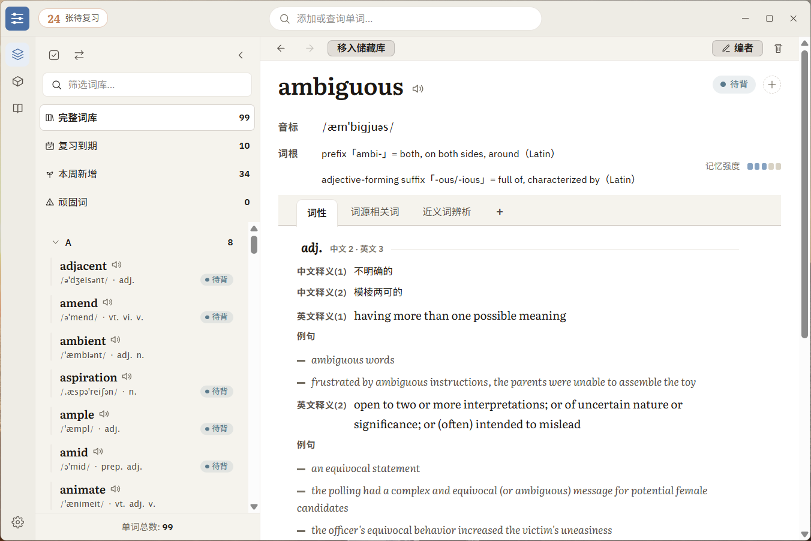

**词典返回页 · 词典 Tab** —— 双离线词典合并为一页、同词性窗格、行尾来源标记、导航条加入动作

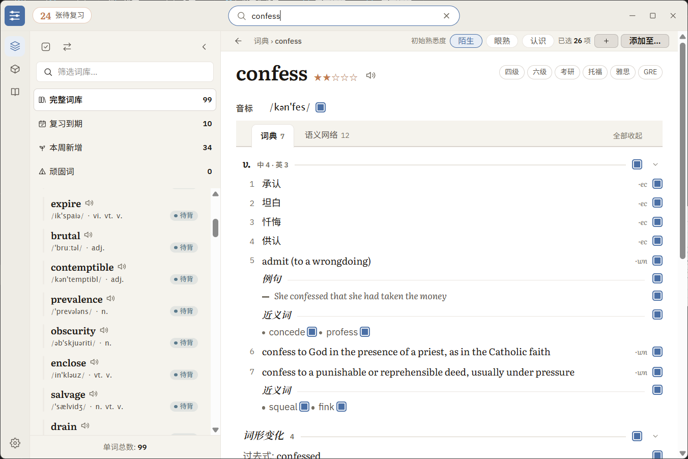

**语义网络 Tab** —— 关系分组与上位词路径

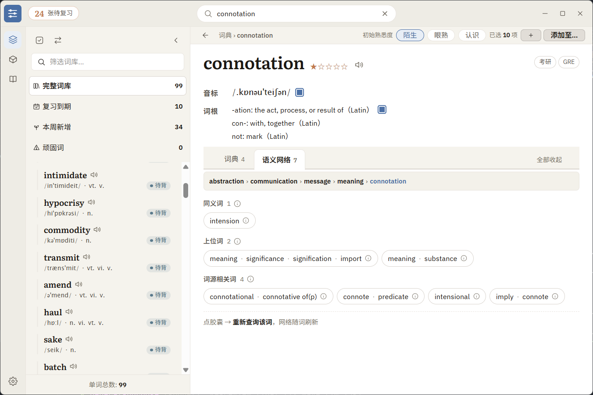

**词条编辑工作台** —— 词性分组窗格与三态字段编辑

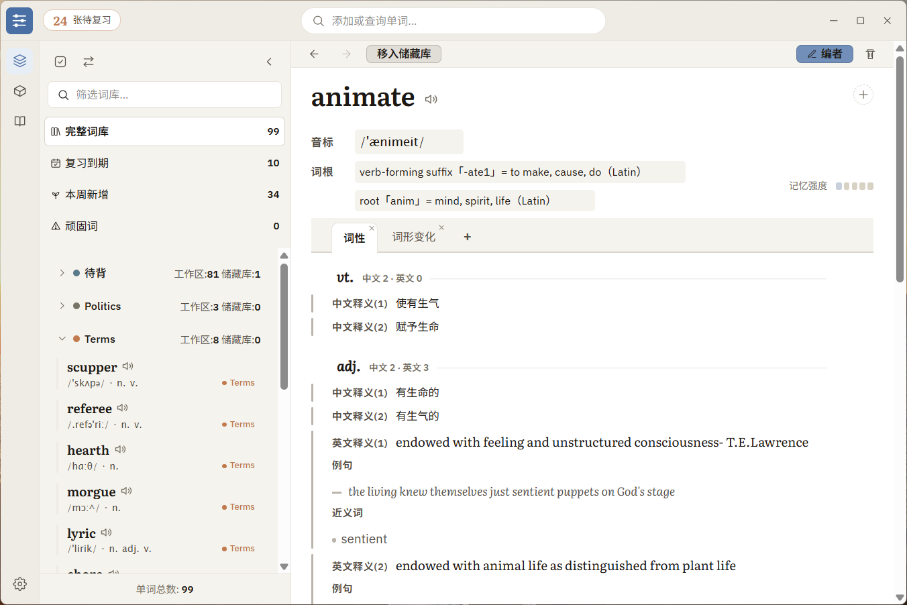

**储藏库** —— 与工作台同一套界面、不含智能视图；左下角计数随模块切换

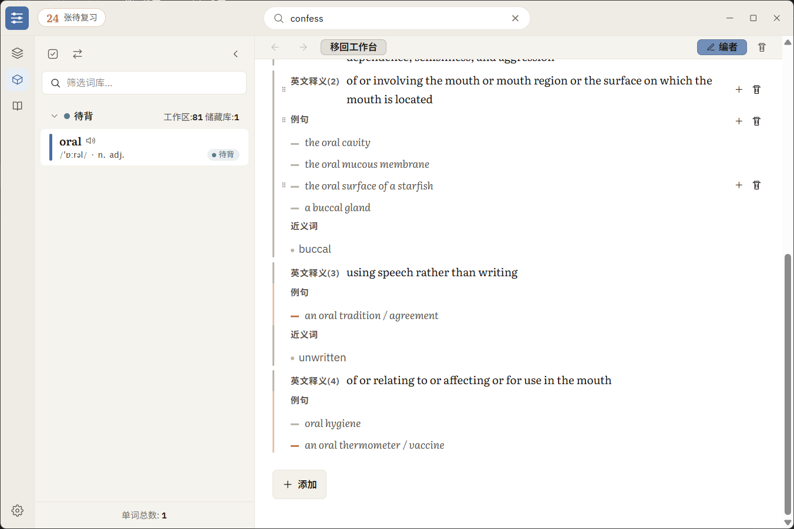

**设置 · 双向链接** —— 词典链接 `{{ }}` 与词库链接 `[[ ]]` 的源词统计与明细列表

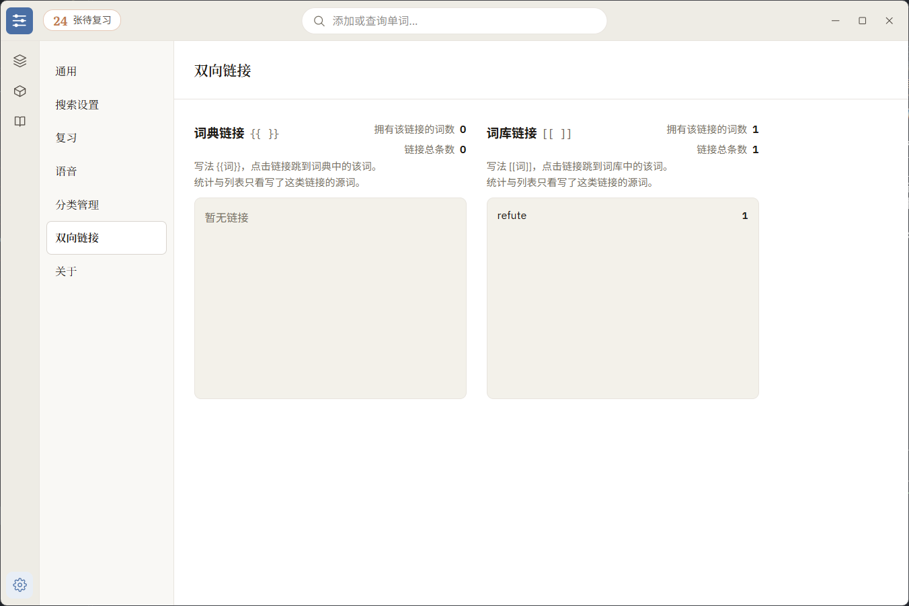

**今日复习 · 概览** —— 左栏待复习计数与新词额度，右栏遗忘曲线、明日压力、熟知度分布与正确率四张卡

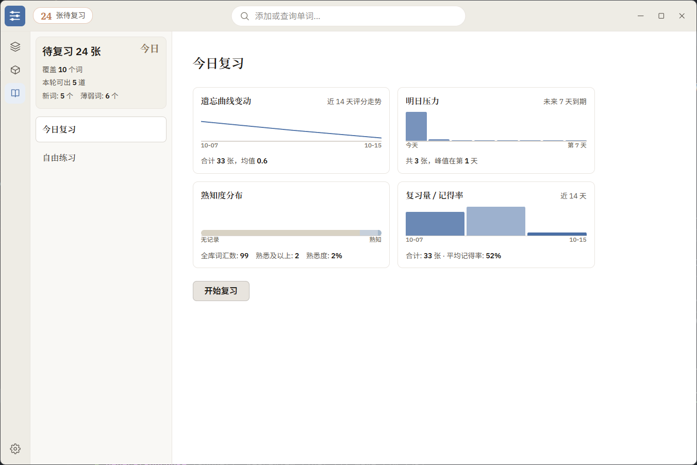

**复习 · 答题** —— 英文释义题：作答 / 正确答案 / 正误三栏，下方跟完整词条

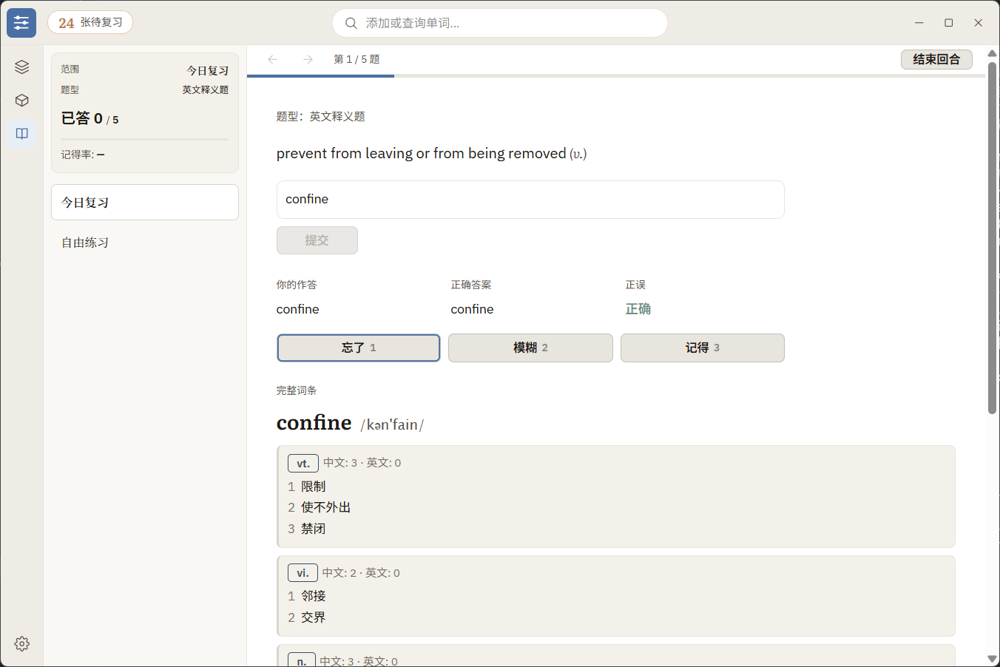

**复习 · 薄弱词专项** —— 连错与近 7 天答错的词，按错次排序

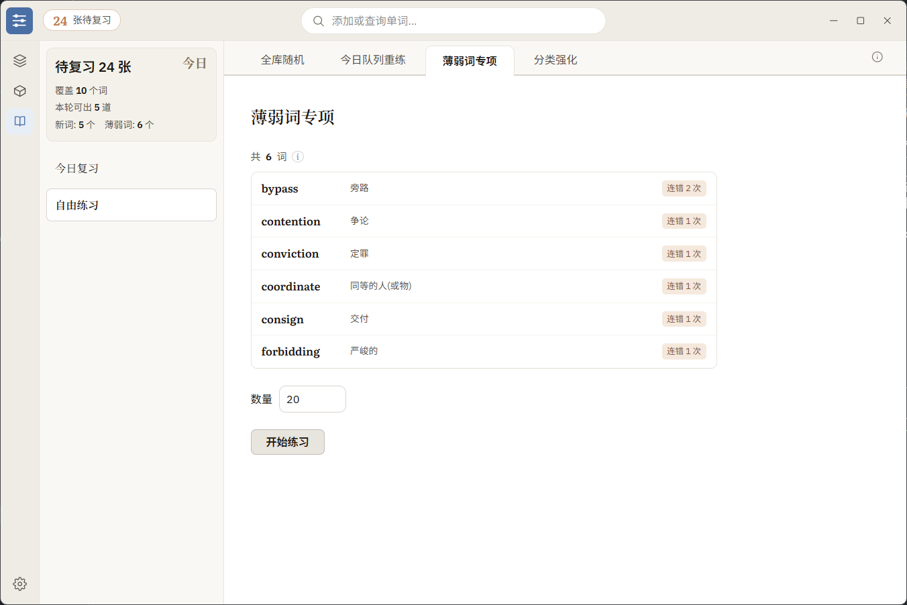

**设置 · 复习** —— 听辨音色、期望记忆保留率、薄弱词阈值、新词额度与队列上限

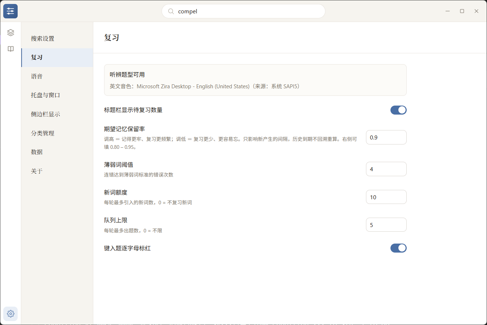

**设置 · 通用（深色）** —— 外观三档、侧边栏显示模式与智能视图开关

**设置 · 关于 · 数据** —— 数据存储位置与词库导入导出

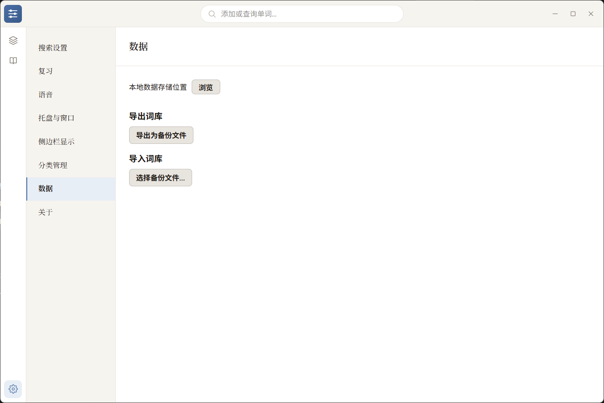

## 下载与安装

### 安装

前往 [GitHub Releases](https://github.com/Olympayus/Wordsett/releases) 下载对应系统的安装包：

| 系统 | 安装包 |
|------|--------|
| **Windows** | `Wordsett_0.7.10_x64-setup.exe`（当前发布提供；MSI 暂未随包） |
| **macOS** | `Wordsett_0.7.10_aarch64.dmg`（Apple 芯片；Intel 机型为 `Wordsett_0.7.10_x64.dmg`） |
| **Linux** | `Wordsett_0.7.10_x86_64.AppImage` / `.deb`（在 Linux 上构建；暂未提供） |
| **Android** | `Wordsett_0.7.10_android-universal.apk`（通用包，含 arm64-v8a 与 armeabi-v7a） |
| **iOS** | 未签名 `.ipa`（需在 Windows 上侧载，见下） |

下载后**双击运行安装程序**，跟随向导即可完成安装；开始菜单会出现 **Wordsett** 图标。

### Android 安装

Android 版以 **universal APK** 发布（同一个包同时含 arm64-v8a 与 armeabi-v7a）：

1. 在 [GitHub Releases](https://github.com/Olympayus/Wordsett/releases) 的对应版本里下载 `Wordsett_0.7.10_android-universal.apk`；
2. 在手机上打开安装包，按系统提示允许该来源**安装未知应用**，然后继续安装；
3. **覆盖升级**直接安装新版即可，无需先卸载：本应用每次发布都用**同一把签名密钥**签名，新版能覆盖旧版并保留数据；
4. **手机与电脑的数据彼此独立**，不会自动同步；换机或与桌面互搬时，用 **设置 → 关于 → 数据** 的导出 / 导入备份搬运；
5. **卸载应用会清除手机上的本地数据**（词库与设置），卸载前请先导出备份。

> 手机版不走桌面式的应用内更新：启动时会静默检查新版本，发现新版后设置入口出现小圆点，到 **设置 → 关于** 点「前往 GitHub 下载」手动下载安装。

### iOS 安装（Windows 侧载）

iOS 版（要求 iOS 15.4 及以上；工程部署目标为 14.0，但 14–15.3 未验证）以**未签名 IPA** 随 [GitHub Releases](https://github.com/Olympayus/Wordsett/releases) 发布（CI 产物名为 `wordsett-ios-unsigned`）。iPhone 与 iPad 使用**同一个 IPA**；签名与安装全部在 Windows 上完成，不需要 Mac，也不经过 App Store。

**从哪里下载 IPA**：优先取 Releases 对应版本附件里的 `.ipa`（tag 构建会把裸 IPA 直接附上）；如果只看到 Actions 的 `wordsett-ios-unsigned` artifact，那是含 IPA 的压缩包，解压后取里面的 `.ipa`。

1. **准备电脑端工具**：从 Apple 官网下载安装 **iTunes**（不要用 Microsoft Store 版，它缺少设备组件），再安装 [Sideloadly](https://sideloadly.io/)。用数据线连接 iPhone / iPad，并在设备上点「信任此电脑」。
2. **打开开发者模式**（iOS 16 及以上）：**设置 → 隐私与安全性 → 开发者模式** → 打开 → 按提示重启并确认。若看不到这一项，先用 Sideloadly 连接一次设备再回来查看。
3. **签名安装**：把下载到的 `.ipa` 拖进 Sideloadly，选中你的设备，Apple ID 填**免费 Apple ID**，点 Start。Sideloadly 在电脑本地完成与 Apple 的签名流程；开启了双重认证的账号按它的提示操作。
4. **信任证书**：安装完成后，在设备上打开 **设置 → 通用 → VPN 与设备管理 → 开发者 App**，选中你的 Apple ID 并点「信任」，再回桌面启动 Wordsett。

免费 Apple ID 侧载的三条限制：

- **7 天续签**：免费签名 7 天后过期，App 会打不开（数据仍在）。到期前用同一个 Apple ID 在 Sideloadly 里重新签名安装即可。
- **每台设备最多 3 个 App**：同一个免费 Apple ID 在一台设备上同时最多保留 3 个自签名 App。
- **同一 bundle ID 覆盖安装保数据**：升级时把新 IPA 直接拖进 Sideloadly 覆盖安装，**不要先删除 App**——相同 bundle ID 覆盖安装会保留词库与设置；删除 App 会清除本地数据，卸载前请先在 **设置 → 关于 → 数据** 导出备份。

> iPad 使用同一个 IPA，安装步骤与 iPhone 相同。iOS 版同样不走应用内更新：新版本需重新下载 IPA 并覆盖签名安装。

### 应用内更新

**桌面版**安装后无需手动卸载重装：启动时若检测到新版本会弹窗提示，也可在 **设置 → 关于 → 检查更新** 手动检测并直接升级；更新过程保留你的个人词库数据。

> **升级无需重建词典**：词典数据库（`ecdict.db` / `wordnet.db`）与应用数据分开存放，应用更新不会影响它们。`npm run build:dictionaries` 只在**全新克隆**后需要执行一次；正常升级安装包不需要。

### 从源码构建（开发者）

> 开发者请参阅项目根目录的 `CLAUDE.md`（含环境准备、词典库生成、常用脚本）。

## 升级与更名

v0.5 起应用更名为 **Wordsett**，应用数据目录随标识符变更（`com.lexiloom.app` → `com.wordsett.app`）。
已收录词库如需保留，请手动把旧库文件复制到新位置后重启：

- Windows：`%APPDATA%\com.lexiloom.app\lexiloom.db` → `%APPDATA%\com.wordsett.app\wordsett.db`
- macOS：`~/Library/Application Support/com.lexiloom.app/lexiloom.db` → `…/com.wordsett.app/wordsett.db`

复制后重启应用。设置项将恢复默认。

## 快速上手

1. **搜词** —— 顶栏输入英文或**中文**，选择联想建议。
2. **预览** —— 词典 Tab 查看 ECDICT / WordNet 详情，词性组可展开，勾选字段。
3. **探索** —— 切到「语义网络」Tab，沿上位词路径与关系胶囊继续探索相关词。
4. **加入词库** —— 在词典 Tab 勾选字段（导航条右端显示「已选 N 项」），点「**＋**」整合两源内容并跳转编辑页；想同时归进某个分类就点「**添加至…**」，选好目的地再添加。
5. **沉淀** —— 在编辑页用「编者模式」补充释义、例句、近义词、派生词等分层字段。
6. **组织** —— 给单词分配彩色分类，在侧边栏按字母或分类浏览。
7. **划词** —— 在其他应用里选中生词或整句，按 **Alt + W**（macOS **Option + W**），在小窗里确认词义，Enter 直接收录。
8. **备份** —— 设置 → 关于 → 数据 → 导出词库为备份文件，需要时导入恢复。

## 卸载

**Windows**

- 方式一：`设置 → 应用 → 已安装的应用 → Wordsett → 卸载`；
- 方式二：`控制面板 → 程序 → 程序和功能 → Wordsett → 卸载`；
- 方式三：从开始菜单运行「卸载 Wordsett」。

**macOS**：将 `Wordsett.app` 拖入废纸篓。

**Linux**：使用发行版的软件包管理器移除（如 `sudo apt remove wordsett`）。

> **注意**：卸载时勾选框可让你选择**是否同时删除个人数据**（词库数据库与设置）。默认不勾选，个人数据会保留，重装后仍可读回；勾选后彻底删除。备份只需复制 `wordsett.db`。

## 数据与隐私

- 全部数据保存在本机，无账号、无遥测。
- 词库数据库：`%APPDATA%\com.wordsett.app\wordsett.db`（Windows，macOS/Linux 位于对应的应用数据目录）。
- 应用设置：通过本地存储保存在应用数据目录中。
- 备份：直接复制 `wordsett.db` 即可备份整个词库。

## 许可

**MIT License** —— 代码采用 MIT 协议开源（详见 [`LICENSE`](LICENSE)）。内置词典数据（ECDiCT / WordNet 3.0）保留各自的第三方许可与署名要求，见 LICENSE 文件的 Third-Party Notices 部分。
